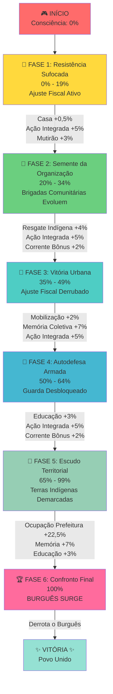

# 📊 Diagrama de Progressão: Consciência Coletiva

## Mermaid: Progressão de Fases com Novas Mecânicas



---

## Fluxo de Ações: Como as Mecânicas Conectam

```mermaid
graph LR
    CIDADE["🏙️ CIDADE"] 
    CAMPO["🌾 CAMPO"]
    FLORESTA["🌳 FLORESTA"]
    
    CIDADE -->|"👥 Mobilização"| CIDADE
    CIDADE -->|"🔧 Equipamentos"| FLORESTA
    CIDADE -->|"🏛️ Ocupação"| CIDADE
    
    CAMPO -->|"🤝 Mutirão"| CAMPO
    CAMPO -->|"🌽 Alimentos"| CIDADE
    CAMPO -->|"💧 Nascentes"| CAMPO
    
    FLORESTA -->|"📚 Educação"| CIDADE
    FLORESTA -->|"🌿 Resgate"| FLORESTA
    FLORESTA -->|"🔮 Memória"| FLORESTA
    FLORESTA -->|"📢 Captura"| CIDADE
    
    ⚡["⚡ CORRENTE<br/>2+ ações<br/>15 segundos"]
    
    CIDADE -.->|"Combo"| ⚡
    CAMPO -.->|"Combo"| ⚡
    FLORESTA -.->|"Combo"| ⚡
    ⚡ -.->|"Bônus +2%"| CIDADE
    
    style CIDADE fill:#ffd93d,stroke:#333,stroke-width:2px
    style CAMPO fill:#6bcf7f,stroke:#333,stroke-width:2px
    style FLORESTA fill:#4ecdc4,stroke:#333,stroke-width:2px
    style ⚡ fill:#ff6b9d,stroke:#333,stroke-width:3px
```

---

## Pyramid: Importância das Mecânicas por Fase

```
FASE 6 (100%):
    🏆 Burguês Final
    ├─ Todas 7 mecânicas disponíveis
    └─ Máxima liberdade estratégica
          ▲
          │
FASE 5 (65-99%):
    🏛️ Ocupação Prefeitura (pressão política)
    🔮 Memória Coletiva (regeneração)
    📚 Educação (consciência móvel)
    ⚡ Corrente (sinergia)
          ▲
          │
FASE 4 (50-64%):
    📚 Educação Ambiental
    Todas as anteriores
          ▲
          │
FASE 3 (35-49%):
    👥 Mobilização Popular
    🔮 Memória Coletiva
    Ações Integradas
          ▲
          │
FASE 2 (20-34%):
    🌿 Resgate Indígena (automática!)
    ⚡ Corrente Solidariedade
    Ações Integradas
          ▲
          │
FASE 1 (0-19%):
    🎮 Foundation
    ├─ Casas +0,5%
    ├─ Ações Integradas +5%
    └─ Mutirão +3%
```

---

## Timeline: Quando o Jogador Usa Cada Mecânica

```
┌─ FASE 1 ────────────────────────────────────┐
│                                              │
│  T=0:10:  Clica Ação Integrada              │
│           → +5% Consciência                  │
│                                              │
│  T=0:30:  Clica Casa (Doação)               │
│           → +0,5% Consciência                │
│                                              │
│  T=1:00:  Clica Mutirão (Campo)             │
│           → +3% Consciência                  │
│           → Escudo 25s                       │
│                                              │
│  Total FASE 1: ~8-10% por minuto            │
└──────────────────────────────────────────────┘

┌─ FASE 2 ────────────────────────────────────┐
│                                              │
│  T=0:00:  Encantado expira                  │
│           Sistema sugere "Resgate Indígena"  │
│                                              │
│  T=0:01:  Clica "Celebrar Captura"          │
│           → +4% Consciência (automático!)    │
│           → -10s próxima invocação          │
│                                              │
│  T=0:10:  Clica Ação Integrada 1            │
│           → +5% Consciência                  │
│                                              │
│  T=0:12:  Clica Ação Integrada 2            │
│           → +5% Consciência                  │
│           → CORRENTE DETECTADA!              │
│           → +2% BÔNUS automático             │
│           → -40% cooldown ambas              │
│                                              │
│  Total FASE 2: ~16% em 12 segundos         │
│               = ~80% por minuto!             │
└──────────────────────────────────────────────┘

┌─ FASE 3 ────────────────────────────────────┐
│                                              │
│  T=0:00:  Clica Mobilização Popular         │
│           → +2% Consciência                  │
│           → Trabalhadores +15% por 20s      │
│           → -3s cooldown ação integrada     │
│                                              │
│  T=0:30:  Clica Ritual Memória Coletiva    │
│           → Duração 25s                      │
│           → Durante: Árvores regeneram      │
│                                              │
│  T=0:55:  Ritual termina                    │
│           → +7% Consciência (25s passados)   │
│                                              │
│  T=1:00:  Ação Integrada (cooldown reduzido)│
│           → +5% Consciência                  │
│                                              │
│  Total FASE 3: ~14% em 60 segundos         │
└──────────────────────────────────────────────┘

┌─ FASE 4 ────────────────────────────────────┐
│                                              │
│  T=0:00:  Clica Educação Ambiental          │
│           Guarda patrulha cidades (30s)      │
│           → +3% Consciência ao final         │
│                                              │
│  T=0:35:  Clica Ação Integrada              │
│           Cooldown da Educação termina       │
│           → +5% Consciência                  │
│           → -5s Captura (efeito Educação)    │
│                                              │
│  T=0:37:  Clica Captura→Cidade              │
│           (cooldown reduzido em 5s!)         │
│           → +10% Consciência                 │
│                                              │
│  Total FASE 4: ~18% em 37 segundos         │
└──────────────────────────────────────────────┘

┌─ FASE 5 ────────────────────────────────────┐
│                                              │
│  T=0:00:  Clica OCUPAÇÃO PREFEITURA (ativa) │
│           Multidão ocupa...                  │
│           +0,5%/s começou!                   │
│                                              │
│  T=0:20:  Ganho: +10% (20 segundos × 0,5%)  │
│           Cooldowns -50% durante!            │
│                                              │
│  T=0:22:  Clica Ação Integrada              │
│           (Recarga reduzida 50%!)            │
│           → +5% + Bônus +2% (combo)          │
│           → Corrente!                        │
│                                              │
│  T=0:45:  Clica OCUPAÇÃO novamente (desativa)│
│           Multidão sai...                    │
│           Ganho total ocupação: +22,5%       │
│           ⚠️ REPRESÁLIA: +60s incendiários   │
│                                              │
│  Total FASE 5: ~39,5% em 45 segundos       │
│               = ~52% por minuto!             │
└──────────────────────────────────────────────┘

┌─ FASE 6 ────────────────────────────────────┐
│                                              │
│  💥 BURGUÊS SURGE                            │
│                                              │
│  Usar TODAS as mecânicas para derrotar!     │
│                                              │
│  ✨ VITÓRIA FINAL                            │
│                                              │
└──────────────────────────────────────────────┘
```

---

## Gráfico: Ganho de Consciência por Minuto

```
% Consciência / Minuto
│
100 │                                    🔛 Ocupação
    │                                   /  (52% PM)
 80 │
    │                          📚⚡🔮
 60 │                         (49% PM)
    │
 40 │           🌿⚡          🎪🤝👥⚡
    │          (51% PM)      (40% PM)
 20 │  🏠⚡
    │ (20% PM)
  0 │_____________________________________________
    FASE1  FASE2  FASE3  FASE4  FASE5  FASE6
    0-19%  20-34% 35-49% 50-64% 65-99% 100%

Legenda:
🏠 Casas
⚡ Corrente
🌿 Resgate Indígena
🎪 Mobilização
🤝 Mutirão
👥 Educação
🔮 Memória
🔛 Ocupação Prefeitura

PM = Porcentagem por Minuto (em uso ótimo)
```

---

## Matriz: Como Diferentes Mecânicas se Complementam

```
                FASE 1→2   FASE 2→3   FASE 3→4   FASE 4→5   FASE 5→6
                ─────────────────────────────────────────────────────
Ação Integrada  Base 5%    Base 5%    Base 5%    Base 5%    Base 5%

Automáticos     Corrente⚡  Resgate🌿  -          -          -
                +2%        +4%

Locais          Mutirão🤝   Mutirão    Mob👥      Mob        Mob
                +3%        Mob👥      +2%        +2%        +2%
                           +2%

Setoriais       -          -          Mem🔮      Edu📚      Edu📚
                                      +7%        +3%        +3%

Especiais       -          -          -          -          Ocup🏛️
                                                             +0.5%/s

Flow Total      ~20%/min   ~51%/min   ~40%/min   ~49%/min   ~52%/min

Strategy        Acumular   Combinar   Equilibrar Educação   Pressão
Focus           bases      sinergias  ritmos     contínua   política
```

---

## Exemplo: Sequência Ideal de Jogo (Fase 5)

```
                      🏛️ OCUPAÇÃO PREFEITURA
                      (Pressão Política Contínua)
                      ▼ +0,5%/s (até 90s)
          ┌─────────────────────────────────┐
          │                                  │
    T=0s: Ativa                        T=45s: Desativa
          ✨ +0,5% início              ✨ +22,5% total
          Cooldowns -50%               ⚠️ Represália
          
          Durante ocupação:
          
    T=5s:  Ação Integrada 1
           ✨ +5% (cooldown reduzido)
           
    T=8s:  Ação Integrada 2 (na janela!)
           ✨ +5% + Corrente +2%
           🌟 -40% cooldown ambas!
           
    T=20s: Continuando ocupação
           ✨ +10% (de T=0 até aqui)
           
    T=25s: Ação Integrada 3
           ✨ +5%
           
    T=45s: Desativa Ocupação
           ✨ +22,5% ganho puro
           
           TOTAL: 22,5 + 5 + 5 + 2 + 5 = 39,5%
           TEMPO: 45 segundos
           TAXA: 52% por minuto!
           
           MAS: Represália causa caos
           Jogador precisa defender!
```

---

## Checklist de Progressão Esperada

- [ ] **T=0:00** - Jogo começa (Fase 1)
- [ ] **T=2:00** - Fase 2 desbloqueada (+20%)
- [ ] **T=3:30** - Fase 3 desbloqueada (+35%)
- [ ] **T=4:45** - Fase 4 desbloqueada (+50%)
- [ ] **T=6:00** - Fase 5 desbloqueada (+65%)
- [ ] **T=7:20** - Fase 6 - Burguês surge (100%)
- [ ] **T=8:30** - Vitória (Burguês derrotado)

*Tempos com novo sistema de mecânicas (uso otimizado)*

---

## Resumo: O Arco Completo

```
           POVO DESUNIDO              POVO UNIDO E CONSCIENTE
           ↓                          ↓
    🏚️ Casas isoladas          👥 Mobilizações urbanas
    🌾 Agricultura fraca       🤝 Mutirões organizados
    🌳 Floresta em risco       🌿 Encantados ativados
                               🎓 Educação ambiental
                               ⚡ Solidariedade
                               🏛️ Ocupação política
                               🔮 Memória ancestral
                               
                               = 100% CONSCIÊNCIA
                               = POVO VENCE O BURGUÊS
                               = FLORESTA SALVA
                               = TERRA LIBERTADA
```

